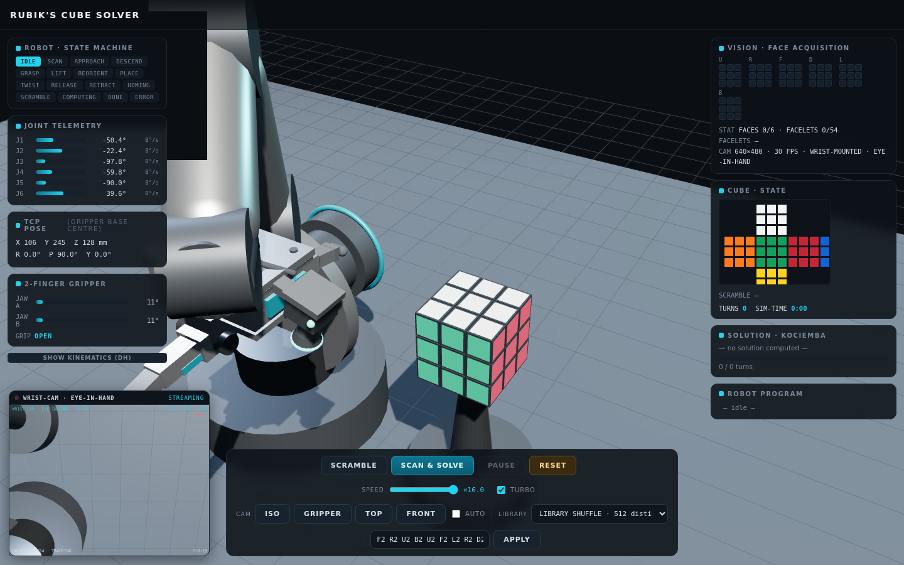

# Rubik's Cube Solver — Robotic Arm Simulation

A 3D browser simulation of a vision-guided robotic cell that scans and solves a
Rubik's Cube. A 6-DOF articulated arm with a **2-finger gripper** and a
**wrist-mounted eye-in-hand camera** flies around the cube, acquires all six
faces, computes a solution with a real **Kociemba two-phase solver**, and
executes it with planned grasps, in-hand rolls and layer twists.

The whole application ships as **one dependency-free HTML file** — no network
requests, no build step required to run it, works offline.



## Quick start

**Option A — just open it.**
Open `index.html` in any modern browser (Chrome, Edge, Firefox, Safari).

**Option B — GitHub Pages.**
Push this repository, then in the repo settings enable
*Settings → Pages → Deploy from a branch → root*. The demo is served at
`https://<user>.github.io/<repo>/`.

**Option C — local static server.**

```bash
npm run serve     # serves the folder at http://localhost:3000
```

Then press **SCRAMBLE**, and **SCAN &amp; SOLVE** to watch the full autonomous
pipeline.

## Features

- **6-DOF articulated arm** — standard DH parameters, forward kinematics,
  joint limits and keep-out collision zones (view the DH table in the UI).
- **Inverse kinematics** — analytic + damped least-squares (DLS) numerical
  solver with joint-limit clamping and collision-aware reachability probes.
- **2-finger gripper** — parallel jaws with animated open/close strokes and
  soft fingertip pads; pinches cube layers and whole-cube rolls.
- **Eye-in-hand vision** — a camera mounted on the wrist feeds a live
  picture-in-picture view; during the scan phase it acquires the 54 facelets
  of all six faces, exactly like a real vision-driven cell.
- **Kociemba two-phase solver** — the actual algorithm (via `cubejs`),
  running in a Web Worker so the UI never blocks. Any scramble, not a canned
  animation.
- **512-entry scramble library** — every entry is machine-verified to
  produce a distinct, non-solved cube state: the featured constructions
  (superflip, half-turn meshes, loop weaves, mirror weaves) plus seeded
  random pools across depth tiers (12 / 20 / 25 / 35 moves), a
  clockwise-quarter-turn family, a double-turn stripe family and mixed
  depths. The `SCRAMBLE` button draws from a shuffle bag that never
  repeats until all 512 have been used; an `∞ true-random` mode and a
  pin-any-entry selector are one click away.
- **Task-level motion planner** — grasp/twist planning with in-place layer
  twists, whole-cube reorientations only when needed, and trapezoidal
  velocity profiles.
- **Full telemetry UI** — state-machine phase tracking, joint telemetry with
  velocity readouts, TCP pose, the DH parameter table, solution chips with
  progress, and the live robot program listing.
- **Speed control** — a ×0.25–16 slider plus a 4× turbo toggle, both applied
  live; custom scramble sequences (`R U R' F2 …`) can be typed in directly.

## The pipeline

1. **SCAN** — the arm presents each cube face to the wrist camera; six face
   reads assemble the 54-facelet color string (validated against the physical
   cube before solving).
2. **SOLVE** — Kociemba two-phase on the scanned facelet string.
3. **EXECUTE** — the planner emits a robot program of joint moves, gripper
   actions, in-hand rolls and layer twists; the runtime executes it while
   telemetry streams to the UI.

## Repository structure

```
├── build.js              # assembles src/ into the single-file index.html
├── index.html            # prebuilt, self-contained demo (GitHub Pages ready)
├── docs/screenshot.png
├── tools/
│   └── gen-scrambles.js  # regenerates src/scrambles.js deterministically
├── src/
│   ├── template.html     # UI shell: layout, styling, script placeholders
│   ├── app.js            # scene, robot cell, state machine, vision, runtime
│   ├── kinematics.js     # DH model · FK · IK (analytic + DLS) · trajectories
│   ├── planner.js        # scan / grasp / twist / reorient motion planning
│   ├── cube-core.js      # 27-cubie logical cube model and move algebra
│   ├── scrambles.js      # auto-generated 512-entry scramble library
│   ├── controls.js       # orbit camera controls
│   └── vendor/           # three.js r147 + cubejs (both MIT)
```

## Building from source

Any edit in `src/` is rebuilt into the single file with plain Node.js — no
npm packages required:

```bash
node build.js        # or: npm run build
```

`build.js` inlines three.js, cubejs and every module into
`src/template.html` and writes `index.html` (~920 KB) to the repository root.

The scramble library is data, not code — regenerate it deterministically
(same 512 scrambles on every machine) with:

```bash
node tools/gen-scrambles.js src/cube-core.js src/scrambles.js
```

## Controls

| Control | Action |
| --- | --- |
| `SCRAMBLE` | apply the next scramble: library shuffle bag (512 distinct, no repeats) by default, a pinned entry, or ∞ true random — per the `LIBRARY` selector |
| `LIBRARY` selector | `LIBRARY SHUFFLE` · `∞ TRUE RANDOM` · or pin any of the 512 entries (featured / depth tiers / turn-style families); picking one copies its sequence into the input for hand editing |
| `SCAN & SOLVE` | run the full vision → solver → execution pipeline |
| `PAUSE` / `RESUME` | freeze or continue the running program |
| `RESET` | home the arm and restore a solved cube |
| `SPEED` slider + `TURBO` | live playback speed ×0.25–16 (turbo ×4 more) |
| `CAM` (`ISO` / `GRIPPER` / `TOP` / `FRONT` / `AUTO`) | scene camera presets |
| scramble input + `APPLY` | custom scramble in standard notation |
| mouse | left-drag orbit · wheel zoom · right-drag pan |

## Credits

- [three.js](https://github.com/mrdoob/three.js) r147 (MIT) — WebGL rendering.
- [cubejs](https://github.com/ldez/cubejs) (MIT) — Kociemba two-phase
  Rubik's Cube solver, inlined and run inside a Web Worker.

## License

MIT — see [LICENSE](LICENSE). The inlined third-party libraries keep their
own MIT licenses.
